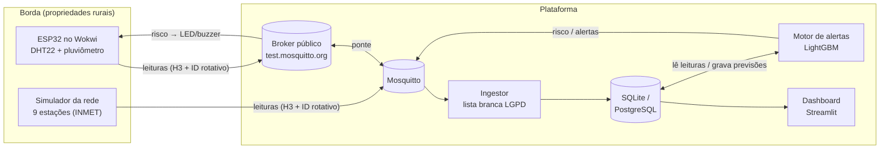

# AgroAlerta — rede colaborativa de alerta de chuva para produtores rurais

Projeto final da disciplina **Internet das Coisas e Aplicações de IA (Big Data)** — UNISINOS
Professores: Cristiano Costa e Rodrigo Righi

**Integrantes:** Alexsander Corvello da Silveira · Daniel Zander · Eder da Silva Paz ·
Matheus Teixeira Rohde · Rafael Augusto da Silva

Propriedades rurais da **Fronteira Oeste e Campanha (RS)** compartilham leituras de suas estações
meteorológicas (pressão, temperatura, umidade, chuva e vento) via **MQTT**. Um modelo de **IA
(LightGBM)**, treinado com 10 anos de dados reais do **INMET**, usa as leituras da rede para prever
**chuva forte (≥ 5 mm) nas próximas 3 horas**. Quando uma tempestade entra pela fronteira, as
propriedades que estão na rota dela recebem o alerta a tempo de recolher o maquinário, suspender a
pulverização ou proteger a colheita: **um produtor avisa o outro**.



## Componentes

| Pasta | O que faz |
|---|---|
| `ia/` | Leitura dos CSVs do INMET, engenharia de atributos, treino e avaliação dos modelos |
| `servicos/simulador.py` | Rede de estações: reproduz eventos reais do INMET ou uma tempestade sintética |
| `servicos/ingestor.py` | Assina o MQTT, valida e grava as leituras (descarta campos fora da lista branca) |
| `servicos/motor_alertas.py` | A cada hora da rede, calcula o risco por estação e publica alertas no MQTT |
| `dashboard/app.py` | Mapa ao vivo, séries por estação, ESP32, métricas do modelo e privacidade |
| `firmware/wokwi/` | Firmware do ESP32 (simulado no Wokwi): publica leituras e reage aos alertas |
| `comum/` | Configuração, banco, parser do INMET, atributos e pseudonimização (compartilhados) |
| `infra/` | Configuração do Mosquitto (com ponte para o broker público) |

## Pré-requisitos

- **Python 3.11 ou mais novo** — confira com `python3 --version` (Windows: `py --version`).
  macOS: `brew install python@3.12` · Linux: `sudo apt install python3 python3-venv` ·
  Windows: [python.org/downloads](https://www.python.org/downloads/) (marque *Add python.exe to PATH*)
- **Git** — [git-scm.com](https://git-scm.com/downloads) (no macOS já vem com as ferramentas de desenvolvedor)
- **Mosquitto** (broker MQTT) e a **biblioteca OpenMP** (usada pelo LightGBM):

| | macOS | Linux (Debian/Ubuntu) | Windows |
|---|---|---|---|
| Mosquitto | `brew install mosquitto` | `sudo apt install mosquitto` | instalador em [mosquitto.org/download](https://mosquitto.org/download/) |
| OpenMP | `brew install libomp` | `sudo apt install libgomp1` | já vem com o LightGBM (requer o Visual C++ Redistributable) |

> **macOS sem Homebrew?** Instale com
> `/bin/bash -c "$(curl -fsSL https://raw.githubusercontent.com/Homebrew/install/HEAD/install.sh)"`
> e rode as duas linhas que o instalador mostrar no final (elas colocam o `brew` no PATH).

> **Não deixe o Mosquitto rodando como serviço**: o `iniciar.py` sobe o broker com a configuração do
> projeto e precisa da porta 1883 livre. No Windows, o instalador cria o serviço *Mosquitto Broker*:
> pare-o em `services.msc` (ou `Stop-Service mosquitto` no PowerShell como administrador) e, se quiser,
> mude a inicialização para *Manual*.

O banco é **SQLite**, criado automaticamente em `dados/agroalerta.db` — nada a instalar. Para usar
PostgreSQL (ou TimescaleDB, recomendado em produção), basta definir `DATABASE_URL` no `.env`.

## 1. Instalação

**macOS / Linux**

```bash
git clone https://github.com/dzpoa/unisinos-agroalerta.git
cd unisinos-agroalerta
python3 -m venv .venv
source .venv/bin/activate
pip install -r requirements.txt
```

**Windows (PowerShell)**

```powershell
git clone https://github.com/dzpoa/unisinos-agroalerta.git
cd unisinos-agroalerta
py -m venv .venv
.venv\Scripts\Activate.ps1
pip install -r requirements.txt
```

> Se o PowerShell bloquear o `Activate.ps1`, rode antes:
> `Set-ExecutionPolicy -Scope CurrentUser RemoteSigned`

Opcional: copie `.env.example` para `.env` para mudar configurações (os padrões já funcionam).

## 2. Executar a demo

Os modelos já treinados com os dados reais estão em `modelos/`, então não é preciso baixar dados.
Em todos os comandos abaixo, o ambiente virtual deve estar ativado (o prompt começa com `(.venv)`).

**Terminal 1 — plataforma** (Mosquitto, ingestor, motor de alertas e dashboard):

```bash
python iniciar.py
```

O script confere os pré-requisitos, sobe os quatro serviços e os acompanha: se algum parar, ele
mostra o final do log e encerra tudo. **Ctrl+C** encerra a plataforma. Os logs ficam em `logs/`.
Se faltar algo (Mosquitto, OpenMP, porta 1883 ocupada), ele diz o que instalar ou fazer.

Abra o dashboard em **http://localhost:8501**. Ele mostra *"Aguardando dados da rede"* até o
simulador começar — isso é o esperado.

**Terminal 2 — rede simulada:**

```bash
# Temporal real de 30/04/2024 (início das enchentes de maio no RS)
python -m servicos.simulador --modo replay --inicio "2024-04-29 09:00" --horas 42

# Outros eventos reais de 2024
python -m servicos.simulador --listar-eventos 10

# Tempestade sintética cruzando a região de oeste para leste
python -m servicos.simulador --modo sintetico
```

**O que esperar:** as primeiras 24 horas do replay são o *aquecimento* (histórico para os atributos)
e passam em segundos; o motor de alertas leva **cerca de 25–30 s** para processá-las. Depois, cada
hora simulada leva 3 s: no mapa, as estações mudam de cor conforme o risco; por volta de
30/04 08h UTC, Santa Maria entra em alerta. A aba *Série por estação* mostra o risco previsto e a
chuva observada.

Opções úteis: `--segundos-por-hora 3` (velocidade da demo), `--ruido 0.3` (ruído de sensor barato),
`--aquecimento 24` (horas iniciais enviadas rapidamente para formar o histórico dos atributos).

## 3. Retreinar com os dados do INMET (opcional)

1. Baixe os arquivos anuais de **2015 a 2024** em **portal.inmet.gov.br/dadoshistoricos**
   (ou direto: `https://portal.inmet.gov.br/uploads/dadoshistoricos/<ano>.zip`).
2. Coloque os ZIPs (ou só os CSVs das 9 estações) em `dados/brutos/`. O script lê dentro dos ZIPs e
   ignora as demais estações.
3. Rode:

```bash
python -m ia.preparar_dados      # gera dados/processados/ e relatorios/cobertura_dados.csv
python -m ia.treinar             # gera modelos/, métricas e gráficos em relatorios/
```

| Papel | Estações |
|---|---|
| Sentinelas (fronteira) | Uruguaiana (A809), São Borja (A830), Quaraí (A831), Santana do Livramento (A804) |
| Intermediárias | Alegrete (A826), Santiago (A833), São Gabriel (A832), Bagé (A827) |
| Alvo principal | Santa Maria (A803) |

> Para testar o pipeline sem os dados reais: `python -m ia.gerar_dados_sinteticos` gera CSVs
> **sintéticos** no mesmo formato em `dados/brutos/sinteticos/`. Não use esses resultados no relatório.

## 4. ESP32 no Wokwi

Com a plataforma rodando (passo 2):

1. Abra o projeto pronto: **https://wokwi.com/projects/481142156492081153** e clique em **▶**.
   A primeira compilação leva de 30 s a alguns minutos.
2. No **Serial Monitor** (parte de baixo) devem aparecer `Conectando ao Wi-Fi... ok`,
   `Conectando ao broker MQTT... ok` e, a cada 10 s, uma linha `[envio] {...}`.
3. No dashboard, a aba **Dispositivo ESP32** passa a mostrar temperatura, umidade e pressão.
4. Rode o replay (passo 2, terminal 2). Após o aquecimento, chega uma linha `[risco] Santa Maria: ...`
   a cada hora simulada; quando há alerta, o **LED vermelho** acende e o **buzzer** toca.

**Interação na demo:** durante a simulação, clique no **DHT22** para mudar temperatura/umidade, gire o
**potenciômetro** (pressão, 990–1025 hPa) e clique no **botão azul** (pluviômetro: 0,2 mm por pulso).

> O Wokwi não tem sensor barométrico; o potenciômetro emula a saída de um BMP280/BME280.
> Logo ao conectar, o ESP32 recebe a última mensagem de risco guardada no broker (mensagem *retida*):
> é o estado da execução anterior, comportamento esperado.

Como funciona: o ESP32 publica no broker público **test.mosquitto.org** (o Wokwi não alcança o
`localhost`); a ponte do Mosquitto local traz as leituras para o sistema e devolve os alertas ao ESP32.

<details>
<summary>Montar o projeto do zero no Wokwi (alternativa ao link)</summary>

1. Abra https://wokwi.com/projects/new/esp32.
2. Substitua o conteúdo das abas `sketch.ino` e `diagram.json` pelos arquivos de `firmware/wokwi/`.
3. Na aba **Library Manager**, adicione: `PubSubClient`, `ArduinoJson`, `DHT sensor library` e
   `Adafruit Unified Sensor`.
4. Clique em **▶**.
</details>

> **Vários integrantes rodando ao mesmo tempo:** todos usam o mesmo prefixo de tópicos
> (`unisinos-agroalerta`) no broker público, então as leituras do ESP32 de um aparecem no sistema do
> outro, e o LED de um pode acender pelo alerta do outro. Para testes independentes (ou no dia da
> gravação), use um prefixo próprio, igual nos três lugares: `MQTT_PREFIXO` no `.env`, as linhas
> `topic` de `infra/mosquitto.conf` e `PREFIXO` no `sketch.ino` (neste caso, use a montagem do zero
> ou faça uma cópia do projeto no Wokwi com *Save a copy*).

## 5. Modelo de IA

- **Alvo:** chuva acumulada ≥ `LIMIAR_MM` (5 mm) nas próximas `HORIZONTE_H` (3) horas.
- **Atributos locais:** chuva acumulada (1/3/6/24 h), pressão e suas variações (1/3/6 h), temperatura,
  umidade, vento (componentes u/v), rajadas, hora do dia e mês (codificação cíclica).
- **Atributos da rede:** chuva, variação de pressão, umidade e rajadas das **estações vizinhas**, com
  defasagens de 1 a 6 h, e agregados (máximo, média e número de vizinhos com chuva).
- **Comparação:** persistência × LightGBM só local × LightGBM local + vizinhos. O ganho do último sobre
  o segundo mede o **valor da rede colaborativa**.
- **Divisão temporal** (sem contaminação (data leakage)): treino 2015–2022, validação 2023 (early
  stopping e limiar de decisão que maximiza o F1), teste 2024.
- **Métricas:** PR-AUC (principal, pois chuva forte é evento raro), F1, precisão, recall, ROC-AUC e Brier.
- Saídas em `relatorios/`: `metricas.csv`, `resumo.json`, `cobertura_dados.csv` e gráficos.

### Resultados (teste em 2024, dados reais do INMET)

| Modelo | PR-AUC médio (9 estações) | PR-AUC Santa Maria |
|---|---|---|
| Persistência | 0,326 | 0,401 |
| LightGBM — só local | 0,461 | 0,529 |
| LightGBM — local + vizinhos | **0,572** | **0,682** |

A rede melhora a previsão em **todas as 9 estações**, e o ganho cresce de oeste para leste: nas
sentinelas da fronteira (Uruguaiana, Quaraí, São Borja) é de +0,02 a +0,04; nas estações a leste
(São Gabriel, Santa Maria, Santiago, Livramento) é de +0,12 a +0,22. É o padrão esperado quando
as tempestades entram pelo oeste: quem está mais adiante na rota se beneficia mais dos avisos de quem
está antes. Em Santa Maria, os atributos mais importantes são a chuva recente nas estações vizinhas.

### O que já vem no repositório

- `modelos/`: modelos treinados com os dados reais (2015–2024) — a demo funciona sem baixar os dados.
- `dados/demo/horario_2024.parquet`: recorte de 2024 (dados públicos do INMET) para o modo replay.
  Ex.: o temporal de **30/04/2024**, início das enchentes de maio no RS:
  `python -m servicos.simulador --modo replay --inicio "2024-04-29 09:00" --horas 42`

## 6. Privacidade (LGPD)

- O dispositivo **nunca envia coordenadas**: envia a **célula H3** (resolução 7, ~5 km²).
- O identificador é um **UUID rotativo diário** (derivado de segredo + dispositivo + data).
- O ingestor aplica uma **lista branca de campos**; qualquer outro é descartado antes de gravar.
- Isto é **pseudonimização**, não anonimização (art. 12 da LGPD): em áreas rurais pouco povoadas, uma
  célula pode corresponder a uma única propriedade.

## Problemas comuns

| Sintoma | Causa provável / solução |
|---|---|
| `iniciar.py` diz que a porta 1883 está em uso | Outro Mosquitto rodando (serviço ou execução anterior). Veja a nota em *Pré-requisitos*. |
| `iniciar.py` diz que o LightGBM não carregou | Falta a biblioteca OpenMP (`brew install libomp` no macOS, `sudo apt install libgomp1` no Linux). |
| Dashboard fica em *"Aguardando dados"* com o simulador rodando | Aguarde o aquecimento (~30 s). Se persistir, veja `logs/motor.log` e `logs/ingestor.log`. |
| ESP32 envia, mas a aba *Dispositivo ESP32* fica vazia | A ponte com o broker público não conectou. Rode `grep -i bridge logs/mosquitto.log`: deve aparecer só *Connecting bridge*, sem *disconnected*/*backoff*. |
| A ponte cai repetidamente | Teste o acesso: `nc -vz -w 5 test.mosquitto.org 1883`. Se falhar, troque para `broker.emqx.io` em `infra/mosquitto.conf` (`address`) e no firmware (`MQTT_HOST`). |
| LED acende sem o replay estar rodando | Mensagem retida da execução anterior, ou outro integrante rodando ao mesmo tempo (veja a nota no passo 4). |

## Tópicos MQTT

| Tópico | Direção | Conteúdo |
|---|---|---|
| `<prefixo>/leituras/simulador/<celula>` | rede → plataforma | leitura horária da estação |
| `<prefixo>/leituras/wokwi/<celula>` | ESP32 → plataforma | leitura a cada 10 s |
| `<prefixo>/risco/<codigo>` (retido) | plataforma → dispositivos | probabilidade e estado de alerta |
| `<prefixo>/alertas/estacao/<codigo>` | plataforma → dispositivos | mensagem de alerta |

## Licença

MIT — ver `LICENSE`.
