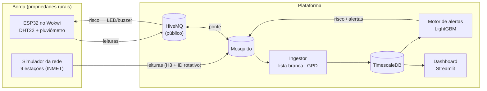

# AgroAlerta — rede colaborativa de alerta de chuva para produtores rurais

Projeto final da disciplina de **Internet das Coisas e Inteligência Artificial** (UNISINOS).

Propriedades rurais da **Fronteira Oeste e Campanha (RS)** compartilham leituras de suas estações
meteorológicas (pressão, temperatura, umidade, chuva e vento) via **MQTT**. Um modelo de **IA
(LightGBM)**, treinado com 10 anos de dados reais do **INMET**, usa as leituras da rede para prever
**chuva forte (≥ 5 mm) nas próximas 3 horas**. Quando uma tempestade entra pela fronteira, as
propriedades que estão na rota dela recebem o alerta a tempo de recolher o maquinário, suspender a
pulverização ou proteger a colheita: **um produtor avisa o outro**.



## Componentes

| Pasta | O que faz |
|---|---|
| `ia/` | Leitura dos CSVs do INMET, engenharia de atributos, treino e avaliação dos modelos |
| `servicos/simulador.py` | Rede de estações: reproduz eventos reais do INMET ou uma tempestade sintética |
| `servicos/ingestor.py` | Assina o MQTT, valida e grava as leituras (descarta campos fora da lista branca) |
| `servicos/motor_alertas.py` | A cada hora da rede, calcula o risco por estação e publica alertas no MQTT |
| `dashboard/app.py` | Mapa ao vivo, séries por estação, ESP32, métricas do modelo e privacidade |
| `firmware/wokwi/` | Firmware do ESP32 (simulado no Wokwi): publica leituras e reage aos alertas |
| `comum/` | Configuração, banco, parser do INMET, atributos e pseudonimização (compartilhados) |
| `infra/` | Configuração do Mosquitto (com ponte para o HiveMQ) |

## Pré-requisitos

- **Com Docker (recomendado):** Docker e Docker Compose.
- **Sem Docker:** Python 3.11+ e um broker MQTT local (ex.: [Mosquitto](https://mosquitto.org/download/)).
  O banco é SQLite (criado automaticamente em `dados/agroalerta.db`).

## 1. Dados do INMET

1. Acesse **portal.inmet.gov.br/dadoshistoricos** e baixe os arquivos anuais de **2015 a 2024**.
2. Coloque os ZIPs (ou só os CSVs das 9 estações) em `dados/brutos/`. O script lê dentro dos ZIPs e
   ignora as demais estações.

| Papel | Estações |
|---|---|
| Sentinelas (fronteira) | Uruguaiana (A809), São Borja (A830), Quaraí (A831), Santana do Livramento (A804) |
| Intermediárias | Alegrete (A826), Santiago (A833), São Gabriel (A832), Bagé (A827) |
| Alvo principal | Santa Maria (A803) |

> Para testar sem os dados reais: `python -m ia.gerar_dados_sinteticos` gera CSVs **sintéticos** no
> mesmo formato em `dados/brutos/sinteticos/`. Não use esses resultados no relatório.

## 2. Execução com Docker

```bash
cp .env.example .env                       # ajuste MQTT_PREFIXO para um valor único do grupo
docker compose build

# Preparar os dados e treinar (gera modelos/ e relatorios/)
docker compose run --rm ia python -m ia.preparar_dados
docker compose run --rm ia python -m ia.treinar

# Subir broker, banco, ingestor, motor de alertas e dashboard
docker compose up -d
# Dashboard: http://localhost:8501

# Rodar a rede simulada (em outro terminal)
docker compose run --rm simulador --modo sintetico
docker compose run --rm simulador --listar-eventos 10          # eventos reais de 2024
docker compose run --rm simulador --modo replay --inicio "2024-05-01 00:00" --horas 42
```

## 3. Execução sem Docker

```bash
python -m venv .venv && source .venv/bin/activate      # Windows: .venv\Scripts\activate
pip install -r requirements.txt
cp .env.example .env                                   # opcional: os padrões já funcionam localmente

python -m ia.preparar_dados
python -m ia.treinar

mosquitto -c infra/mosquitto.conf                      # terminal 1 (ou outro broker na porta 1883)
python -m servicos.ingestor                            # terminal 2
python -m servicos.motor_alertas                       # terminal 3
streamlit run dashboard/app.py                         # terminal 4
python -m servicos.simulador --modo sintetico          # terminal 5
```

Opções úteis do simulador: `--segundos-por-hora 3` (velocidade da demo), `--ruido 0.3` (ruído de sensor
barato), `--aquecimento 24` (horas iniciais enviadas rapidamente para formar o histórico dos atributos).

## 4. ESP32 no Wokwi

1. Em [wokwi.com](https://wokwi.com), crie um projeto **ESP32** e substitua `sketch.ino` e `diagram.json`
   pelos arquivos de `firmware/wokwi/`; adicione as bibliotecas de `libraries.txt` (aba *Library Manager*).
2. Ajuste `PREFIXO` no firmware para o mesmo valor de `MQTT_PREFIXO` e de `infra/mosquitto.conf`.
3. Inicie a simulação. O ESP32 publica a cada 10 s no HiveMQ; a ponte do Mosquitto entrega ao sistema.
4. **Interação na demo:** ajuste temperatura/umidade no DHT22, gire o potenciômetro (pressão) e clique no
   botão azul (pluviômetro: 0,2 mm por pulso). Quando o motor emite alerta para Santa Maria, o **LED
   vermelho** acende e o **buzzer** toca.

> O Wokwi não tem sensor barométrico; o potenciômetro emula a saída de um BMP280/BME280.

## 5. Modelo de IA

- **Alvo:** chuva acumulada ≥ `LIMIAR_MM` (5 mm) nas próximas `HORIZONTE_H` (3) horas.
- **Atributos locais:** chuva acumulada (1/3/6/24 h), pressão e suas variações (1/3/6 h), temperatura,
  umidade, vento (componentes u/v), rajadas, hora do dia e mês (codificação cíclica).
- **Atributos da rede:** chuva, variação de pressão, umidade e rajadas das **estações vizinhas**, com
  defasagens de 1 a 6 h, e agregados (máximo, média e número de vizinhos com chuva).
- **Comparação:** persistência × LightGBM só local × LightGBM local + vizinhos. O ganho do último sobre
  o segundo mede o **valor da rede colaborativa**.
- **Divisão temporal** (sem contaminação (data leakage)): treino 2015–2022, validação 2023 (early
  stopping e limiar de decisão que maximiza o F1), teste 2024.
- **Métricas:** PR-AUC (principal, pois chuva forte é evento raro), F1, precisão, recall, ROC-AUC e Brier.
- Saídas em `relatorios/`: `metricas.csv`, `resumo.json`, `cobertura_dados.csv` e gráficos.

### Resultados (teste em 2024, dados reais do INMET)

| Modelo | PR-AUC médio (9 estações) | PR-AUC Santa Maria |
|---|---|---|
| Persistência | 0,326 | 0,401 |
| LightGBM — só local | 0,461 | 0,529 |
| LightGBM — local + vizinhos | **0,572** | **0,682** |

A rede melhora a previsão em **todas as 9 estações**, e o ganho cresce de oeste para leste: nas
sentinelas da fronteira (Uruguaiana, Quaraí, São Borja) é de +0,02 a +0,04; nas estações a leste
(São Gabriel, Santa Maria, Santiago, Livramento) é de +0,12 a +0,22. É o padrão esperado quando
as tempestades entram pelo oeste: quem está mais adiante na rota se beneficia mais dos avisos de quem
está antes. Em Santa Maria, os atributos mais importantes são a chuva recente nas estações vizinhas.

### O que já vem no repositório

- `modelos/`: modelos treinados com os dados reais (2015–2024) — a demo funciona sem baixar os dados.
- `dados/demo/horario_2024.parquet`: recorte de 2024 (dados públicos do INMET) para o modo replay.
  Ex.: o temporal de **30/04/2024**, início das enchentes de maio no RS:
  `python -m servicos.simulador --modo replay --inicio "2024-04-29 09:00" --horas 42`

## 6. Privacidade (LGPD)

- O dispositivo **nunca envia coordenadas**: envia a **célula H3** (resolução 7, ~5 km²).
- O identificador é um **UUID rotativo diário** (derivado de segredo + dispositivo + data).
- O ingestor aplica uma **lista branca de campos**; qualquer outro é descartado antes de gravar.
- Isto é **pseudonimização**, não anonimização (art. 12 da LGPD): em áreas rurais pouco povoadas, uma
  célula pode corresponder a uma única propriedade.

## Tópicos MQTT

| Tópico | Direção | Conteúdo |
|---|---|---|
| `<prefixo>/leituras/simulador/<celula>` | rede → plataforma | leitura horária da estação |
| `<prefixo>/leituras/wokwi/<celula>` | ESP32 → plataforma | leitura a cada 10 s |
| `<prefixo>/risco/<codigo>` (retido) | plataforma → dispositivos | probabilidade e estado de alerta |
| `<prefixo>/alertas/estacao/<codigo>` | plataforma → dispositivos | mensagem de alerta |

## Licença

MIT — ver `LICENSE`.
